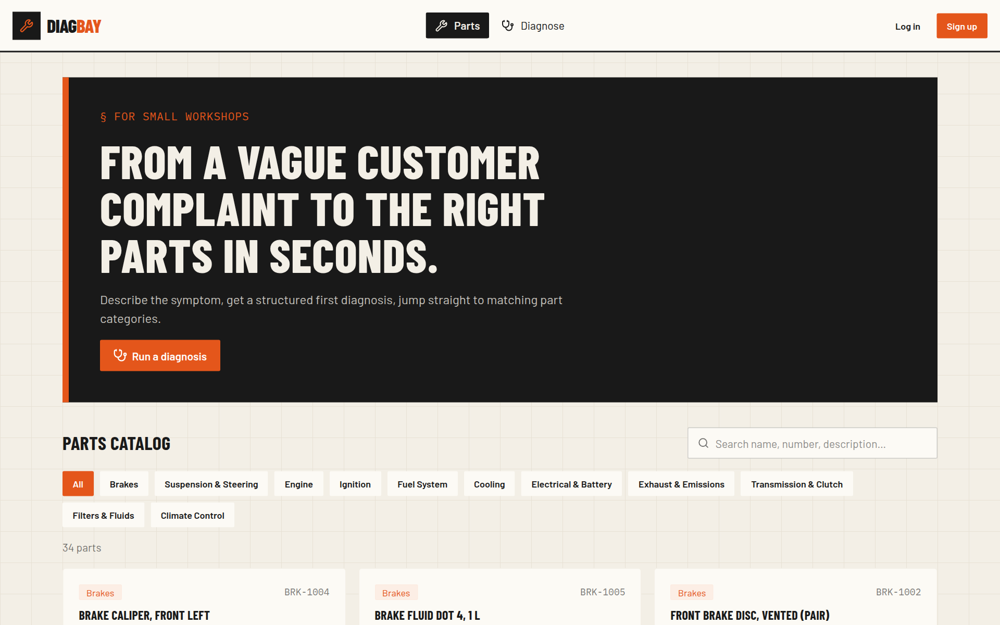
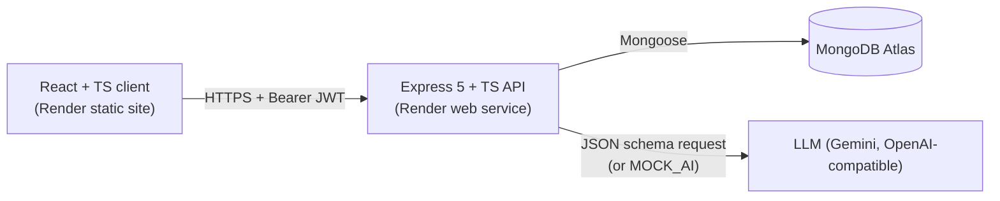
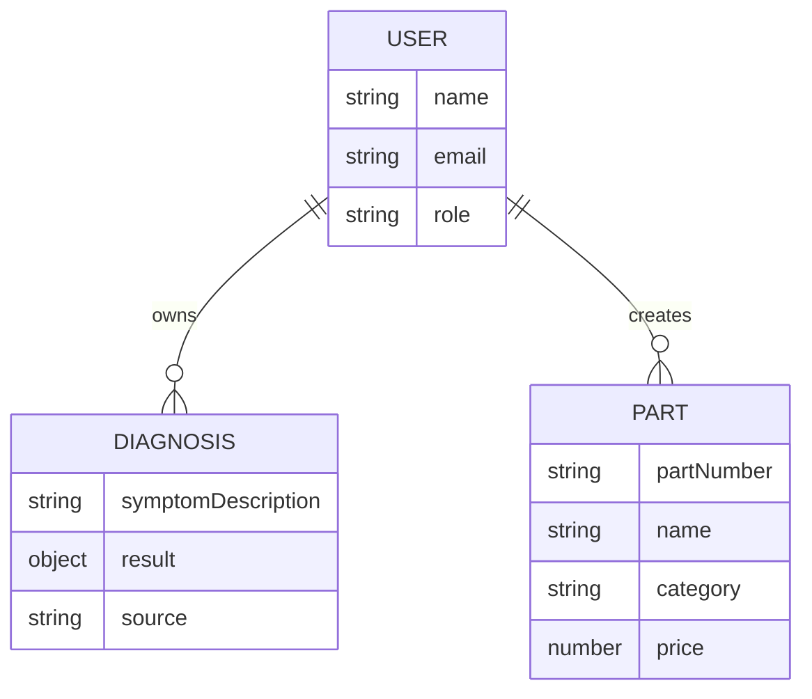

# DiagBay: Vehicle Parts & Diagnostics Catalog

A web app for small car workshops. A technician types in what the customer describes ("grinding noise when braking") and gets back a **structured first diagnosis**: the likely subsystem, possible causes, urgency and confidence. That result sits next to a **searchable parts catalog**, so the technician can go straight from the diagnosis to the right part categories.

Final project · WBS Coding School · AI Software Development · Mohamed Ebrahim · October 2026

**Live:** client `https://<your-client>.onrender.com` · API docs `https://<your-api>.onrender.com/api-docs`

> The first request after about 15 minutes of inactivity takes up to 1 minute, because the free Render instance has to wake up.



## Features (Level 1 / MVP)

| | Feature | Who |
|---|---|---|
| 🔐 | Register, log in, session survives a refresh (JWT + `GET /auth/me`) | everyone |
| 🔎 | Parts catalog with search and category filter, part details | public |
| 🤖 | **AI diagnosis**: symptom text in, zod-validated structured result out, saved to history | logged in |
| 🗂️ | My diagnoses: history, details, delete (only your own; other users get 403) | logged in |
| 🛠️ | Manage parts: create, edit, delete (duplicate part number → 409 shown in the form) | admin |
| 📄 | Swagger UI at `/api-docs` | public |

## The AI feature

```ts
// server/src/schemas/diagnosis.ts: this schema *is* the spec
const diagnosisResultSchema = z.object({
  subsystem: z.string(),
  possibleCauses: z.array(z.string()).min(1).max(5),
  recommendedPartCategories: z.array(z.enum(PART_CATEGORIES)).min(1).max(3),
  urgency: z.enum(['low', 'medium', 'high']),
  confidence: z.number().min(0).max(1)
});
```

1. The client calls `POST /api/diagnoses`. The LLM key exists only on the server.
2. The server sends the zod schema to the model as a JSON schema (`zodResponseFormat`, structured output), then checks the answer again with `JSON.parse` and `safeParse`. The provider is configurable: Gemini (free tier) by default, or Groq, Ollama or OpenAI by changing `AI_BASE_URL` and `AI_MODEL`.
3. If the answer is invalid, the server retries **once**, adding the validation errors to the prompt. If it is still invalid, or the provider times out or fails, the server returns **502** and saves nothing. The UI shows the error and a *Try again* button.
4. `MOCK_AI=1` returns a keyword-based fake diagnosis. The UI was built against it, and it is the backup for the demo.
5. The recommended categories come from a fixed enum, so they always link to a real catalog filter (`/?category=Brakes`).
6. Rate limit: 6 diagnoses per minute per IP, to protect the paid key.

## Architecture





- **Route guards on both sides.** React layouts (`ProtectedLayout`, `AdminLayout`) are there for the UX. Express middleware (`authenticate`, `authorize('admin')`, the ownership check) is what actually protects the data.
- **One fetch layer.** Every request goes through `client/src/utils/api.ts` (token header, error messages, 401 → logout).
- **Central error handler.** `new Error(msg, { cause: { status } })` becomes a JSON error. Mongo `CastError` → 400, duplicate key → 409.
- **CORS** only allows `CLIENT_ORIGIN`.

## Tech stack

React 19 · TypeScript · Vite · React Router 7 · Tailwind CSS 4 + daisyUI 5 · Node 22 · Express 5 · zod · Mongoose 8 / MongoDB Atlas · bcrypt · JWT · OpenAI SDK against any OpenAI-compatible LLM (Google Gemini free tier by default) · swagger-ui-express · Render

## Run locally

```bash
# 1. API
cd server
cp .env.example .env        # fill in MONGODB_URI and JWT_SECRET
npm install
npm run seed                # 34 invented parts, admin + technician, 2 demo diagnoses
npm run dev                 # http://localhost:8080/api/health

# 2. Client (second terminal)
cd client
cp .env.example .env.local
npm install
npm run dev                 # http://localhost:5173
```

Demo accounts after seeding (local only): `admin@diagbay.dev / Admin1234!` · `tech@diagbay.dev / Tech1234!`

## API

| Method | Path | Access |
|---|---|---|
| POST | /api/auth/register · /api/auth/login | public |
| GET | /api/auth/me | logged in |
| GET | /api/parts?q=&category= · /api/parts/categories · /api/parts/:id | public |
| POST · PUT · DELETE | /api/parts · /api/parts/:id | admin |
| POST · GET | /api/diagnoses | logged in |
| GET · DELETE | /api/diagnoses/:id | owner |

Full docs: `/api-docs`.

## Deploy

`render.yaml` is a Render Blueprint (API + static site). Set `MONGODB_URI`, `CLIENT_ORIGIN`, `VITE_API_URL` and `AI_API_KEY` in the dashboard, then set `MOCK_AI=0`. In Atlas → Network Access, allow `0.0.0.0/0`, because Render's free instances have no fixed IP.

## Data and privacy

All parts are invented: no brands, no real part numbers. The symptom text goes to the LLM provider, so the form asks users not to enter names, plates or VINs. A diagnosis is a suggestion for a trained technician, not a safety decision.

## Level 2 (after the course)

A vehicle model from the NHTSA vPIC API · automatic diagnosis → compatible parts matching · a category tree · OBD-II fault codes · job cards, stock and quotes.
